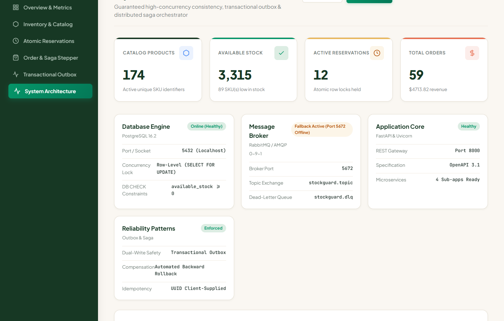
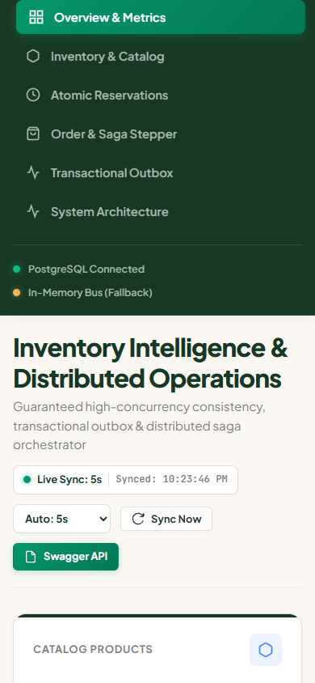

# StockGuard: Distributed Inventory Reservation & Order Reliability Engine

[](https://github.com/rohitam26/stockguard/actions)
[](https://www.python.org/downloads/)
[](https://www.postgresql.org/)
[](https://fastapi.tiangolo.com/)
[](https://opensource.org/licenses/MIT)

StockGuard is a distributed inventory reservation and checkout reliability engine engineered to prevent inventory overselling during high-contention flash sales. It implements transactional isolation, atomic conditional allocations, idempotent client reservations, a transactional outbox event pipeline, and backward-compensating saga orchestration for multi-step order checkout flows.

StockGuard is architected as a modular monolith with decoupled domain boundaries and standalone microservice entrypoints, designed for high auditability and verifiable transactional integrity.

---

## 1. Technology Stack

- **Core Runtime & Framework:** Python 3.11+, FastAPI, Pydantic v2, Pydantic Settings
- **Relational Persistence:** PostgreSQL 16 (psycopg 3 driver), SQLAlchemy 2.0 ORM / Core
- **Database Migrations:** Alembic
- **Asynchronous Messaging:** RabbitMQ 3.13 (aio-pika, Topic Exchanges, Dead Letter Queues) with resilient in-memory fallback
- **Containerization & Orchestration:** Docker, Docker Compose, Kubernetes starter manifests
- **Frontend Console:** Vanilla ES6+ JavaScript, CSS3 Design System (Forest Green & Warm Ivory), HTML5
- **Quality Assurance & Testing:** Pytest, HTTPX, Playwright, Locust, pip-audit

---

## 2. Project Overview

E-commerce checkout platforms face severe concurrency challenges during promotional flash sales and high-velocity traffic spikes. When hundreds of users simultaneously attempt to purchase limited inventory, naive read-modify-write patterns result in race conditions, phantom allocations, and overselling. Furthermore, multi-service checkout workflows risk dual-write inconsistencies and orphan reservations when downstream payments fail.

StockGuard addresses these challenges by consolidating reliable distributed systems patterns:
- **Atomic Concurrency Control:** Enforces strict serializability and row-level atomicity directly at the database layer.
- **Idempotency Protection:** Guarantees that network retries and duplicate user requests cannot duplicate stock deductions.
- **Transactional Outbox:** Eliminates dual-write anomalies by persisting business state mutations and domain event messages within the same atomic database transaction.
- **Saga Orchestration:** Coordinates multi-step order placement workflows with automated backward compensation when payment or fulfillment steps encounter failures.

---

## 3. Key Engineering Problems Solved

1. **Race Conditions and Overselling:** Under high-concurrency spikes, multiple application workers reading the same inventory count can simultaneously evaluate stock as available, decrementing stock beyond physical limits. StockGuard eliminates this with database check constraints, row-level locks, and atomic conditional updates.
2. **Dual-Write Vulnerabilities:** Updating a database record and publishing a message to a broker in separate network calls creates dual-write inconsistency if the broker or server crashes mid-operation. StockGuard uses the Transactional Outbox pattern to commit events directly with state changes.
3. **Partial Failure in Multi-Step Workflows:** If inventory is reserved but payment processing fails, inventory remains locked indefinitely unless systematically released. StockGuard implements an orchestrator-based Saga that executes compensating transactions to restore available inventory upon failure.
4. **Duplicate Request Floods:** Network hiccups often prompt clients to retry checkout submissions. StockGuard validates client-supplied idempotency keys to return existing reservation states rather than creating duplicate allocations.
5. **Silent Message Loss:** Transient network partitions between application workers and message brokers risk message drops. StockGuard includes retry policies, dead-letter routing (`stockguard.dlq`), and an automatic in-memory fallback engine.

---

## 4. Core Features

- **Pessimistic & Conditional Stock Decrements:** Enforces row-level isolation via PostgreSQL `SELECT ... FOR UPDATE` and conditional `WHERE available_stock >= :qty` statements.
- **Client Idempotency Keys:** Every reservation requires a unique key; subsequent calls with identical keys return the original allocation without deducting additional stock.
- **Time-to-Live (TTL) Auto-Expiry Engine:** Reservations carry configurable lifespans (default 600 seconds). A dedicated background worker continuously identifies and releases expired, unconfirmed holds.
- **Transactional Outbox Worker:** Dispatches pending outbox records to RabbitMQ topic exchanges asynchronously with configurable polling and retry tracking.
- **Distributed Saga Orchestrator:** Manages four distinct checkout stages (Inventory Reservation -> Payment Processing -> Fulfillment Dispatch -> Confirmation) with backward rollback on payment denial.
- **Real-Time Synchronized Console:** Operations dashboard featuring 5-second non-overlapping polling, connection state monitoring, live stock charts, and manual restock tools.
- **Decoupled Architecture:** Clean domain separation allowing execution as a unified modular monolith or as independent microservices (`src/stockguard/microservices/`).

---

## 5. Architecture Diagram

```
                       +----------------------------+
                       |      FastAPI Gateway       |
                       |    (REST API & Web UI)     |
                       +--------------+-------------+
                                      |
             +------------------------+------------------------+
             |                        |                        |
    +--------v-------+       +--------v-------+       +--------v-------+
    |   Inventory    |       |  Reservation   |       |     Order      |
    |    Service     |       |     Engine     |       |    Service     |
    +--------+-------+       +--------+-------+       +--------+-------+
             |                        |                        |
             +------------------------+------------------------+
                                      |
                           +----------v----------+
                           |  Saga Orchestrator  |
                           +----+-----------+----+
                                |           |
                       +--------v----+ +----v--------+
                       |   Payment   | | Fulfillment |
                       |  Simulator  | |   Service   |
                       +-------------+ +-------------+
                                |           |
        +-----------------------+-----------+-----------------------+
        |                                                           |
+-------v---------+                                         +-------v---------+
| PostgreSQL 16   |                                         | RabbitMQ Broker |
| - Row Locks     |                                         | - Topic Exch    |
| - CHECK Constr  |                                         | - DLQ Routing   |
| - Outbox Table  | === Polled by Outbox Worker ===========>| - At-Least-Once |
+-----------------+                                         +-----------------+
```

---

## 6. Database and Concurrency Design

StockGuard delegates concurrency safety directly to PostgreSQL rather than relying on distributed application-level locks.

### Concurrency Guarantees
- **Table Constraints:** The `inventory_items` table defines `CHECK (available_stock >= 0)` and `CHECK (reserved_stock >= 0)`. Any operation that would produce negative stock fails immediately at the database engine level.
- **Atomic Conditional SQL:** Stock deductions use single atomic SQL statements:
  ```sql
  UPDATE inventory_items
  SET available_stock = available_stock - :qty,
      reserved_stock = reserved_stock + :qty,
      version = version + 1
  WHERE sku = :sku AND available_stock >= :qty;
  ```
- **Pessimistic Locking:** Critical reservation paths acquire explicit row locks (`SELECT ... FOR UPDATE`) to eliminate race conditions between concurrent readers.

### Verified 100-Request Concurrency Scenario
To verify these guarantees under contention, an automated stress benchmark executes against PostgreSQL:
- **Baseline:** An inventory item initialized with exactly 5 units of available stock.
- **Load Profile:** 100 concurrent reservation requests issued across 20 parallel threads attempting to reserve 1 unit each.
- **Observed Behavior:**
  - Exactly **5 requests succeeded** (HTTP 201 Created).
  - Exactly **95 requests were rejected** (HTTP 409 Conflict, Insufficient Stock).
  - Final database state: `available_stock = 0`, `reserved_stock = 5`, `allocated_stock = 0`.
  - Zero stock leakage, zero deadlocks, and zero overselling occurrences.

---

## 7. Reservation and Idempotency Workflow

```
Client Request
      |
      v
[ Check Idempotency Key ] ---> (Found & Active?) ---> Return Existing Reservation (200 OK)
      | (Not found)
      v
[ Acquire Row Lock: SELECT ... FOR UPDATE ]
      |
[ Check Available Stock >= Requested Qty ]
      |
      +---> (Insufficient) ---> Release Lock & Return 409 Conflict
      |
      +---> (Sufficient)
                  |
                  v
            [ Decrement Available Stock ]
            [ Increment Reserved Stock ]
            [ Insert Reservation Record ]
            [ Insert Outbox Event: reservation.created ]
                  |
                  v
            [ Commit Transaction ]
                  |
                  v
            Return Reservation (201 Created)
```

1. **Idempotency Check:** The request evaluates `idempotency_key` against existing reservations. If a reservation with that key exists, the stored record is returned without re-deducting stock.
2. **Pessimistic Lock & Evaluation:** The SKU row is locked within an active transaction. Available stock is verified against requested quantity.
3. **Atomic Modification:** `available_stock` is decremented, `reserved_stock` is incremented, and reservation status is set to `ACTIVE`.
4. **Auto-Expiry Background Worker:** Active reservations are assigned a TTL timestamp. If not confirmed within this window, the `ExpirationWorker` runs a batch transaction to mark them `EXPIRED`, decrement `reserved_stock`, increment `available_stock`, and write a `reservation.expired` outbox event.

---

## 8. Transactional Outbox Workflow

To eliminate dual-write vulnerabilities between PostgreSQL and RabbitMQ, StockGuard uses the Transactional Outbox pattern:

```
[ Domain Service Transaction ]
     |
     +--- 1. Mutate Domain Entity (e.g. create reservation)
     +--- 2. Insert Event into outbox_messages (status = 'PENDING')
     |
[ Commit DB Transaction ]  <-- Both persist atomically or roll back together
     |
     v
[ Background Outbox Worker ]
     |
     +--- 1. Poll for PENDING outbox messages (SELECT ... FOR UPDATE SKIP LOCKED)
     +--- 2. Publish payload to RabbitMQ Topic Exchange
     +--- 3. Mark message PROCESSED (or increment retry_count on failure)
     +--- 4. Route to stockguard.dlq if retry limit exceeded
```

- **Atomicity:** Events are written in the exact same database transaction as domain mutations.
- **At-Least-Once Delivery:** The worker retries failed publications up to a configured threshold (`RABBITMQ_RETRY_LIMIT = 3`).
- **Dead-Letter Handling:** Poison pills or persistently unroutable messages are forwarded to `stockguard.dlq` for operator investigation.

---

## 9. Saga Orchestration and Compensation

StockGuard implements an orchestrator-based Saga to coordinate checkout flows spanning inventory, payments, and fulfillment:

```
[ Client: POST /api/v1/orders/saga ]
               |
               v
     +-------------------+
     | Saga Orchestrator |
     +---------+---------+
               |
               |--- Step 1: Reserve Inventory (Atomic hold)
               |    [Success]
               |
               |--- Step 2: Process Payment
               |    +---> [Approved] ---> Step 3: Dispatch Fulfillment
               |    |                     +---> [Success] ---> Order Completed (201)
               |    |
               |    +---> [Declined] ---> INITIATE BACKWARD COMPENSATION
               |                               |
               |<------------------------------+
               |
               |--- Compensation Step 1: Release Inventory Hold
               |    (reserved_stock -> available_stock)
               |
               |--- Compensation Step 2: Mark Order FAILED (402 Payment Required)
               |
               v
     [ Client receives structured failure details; stock remains fully balanced ]
```

- **Forward Flow:** Reservations are established first. Upon successful hold, payment is debited, fulfillment is requested, and the reservation is committed to allocated stock.
- **Backward Compensation:** If payment fails (e.g., card declined), the orchestrator immediately triggers compensating actions: releasing the reserved stock back to available inventory and setting the order status to `CANCELLED` or `FAILED`.

---

## 10. Dashboard Screenshots

All screenshots represent authentic captures from the running application console.

### 1. Operations Overview Dashboard
Visualizes inventory balance, active reservation countdowns, low-stock warnings, and real-time operational metrics.


### 2. Inventory & Catalog Intelligence
SKU catalog management with instant stock level filters (`All`, `In Stock`, `Low Stock`, `Depleted`), live search, and manual restocking controls.


### 3. Atomic Stock Reservations
Active client reservation tracking with idempotency keys, real-time TTL countdowns, and manual release actions.


### 4. Distributed Saga Stepper & Backward Compensation
Interactive checkout coordination visualizer showing stage-by-stage progression and backward compensation rollback when payment declines.


### 5. Transactional Outbox Operations Console
Monitors pending, processed, and failed outbox event records with manual event flush controls and message inspection.


### 6. System Architecture & Topology Health
Live service connection status for PostgreSQL, RabbitMQ broker / In-Memory Fallback mode, and background worker state.


### 7. Responsive Mobile Viewport
Adaptive mobile navigation and responsive card layout verified across mobile browser viewports.


---

## 11. Installation and Setup Instructions

### Prerequisites
- Python 3.11 or higher
- PostgreSQL 16 (or local Docker daemon)
- RabbitMQ 3.13 (optional; resilient in-memory broker activates automatically if offline)

### Local Environment Setup

1. **Clone the Repository:**
   ```bash
   git clone https://github.com/rohitam26/stockguard.git
   cd stockguard
   ```

2. **Create and Activate Virtual Environment:**
   ```bash
   python -m venv .venv
   # Linux / macOS
   source .venv/bin/activate
   # Windows
   .venv\Scripts\activate
   ```

3. **Install Dependencies:**
   ```bash
   python -m pip install --upgrade pip
   python -m pip install -r requirements.txt
   pip install -e .
   ```

4. **Configure Environment Variables:**
   Create a `.env` file based on `.env.example`:
   ```bash
   cp .env.example .env
   ```
   Configure the database connection:
   ```env
   DATABASE_URL=postgresql+psycopg://<db_user>:<db_password>@localhost:5432/stockguard
   RABBITMQ_URL=amqp://<rabbitmq_user>:<rabbitmq_password>@localhost:5672/
   RABBITMQ_ENABLED=true
   ENVIRONMENT=development
   ```

5. **Run Database Migrations:**
   ```bash
   python -m alembic upgrade head
   ```

6. **Start the Application:**
   ```bash
   uvicorn stockguard.main:app --host 0.0.0.0 --port 8000 --reload
   ```
   - Dashboard: [http://localhost:8000](http://localhost:8000)
   - Interactive API Docs: [http://localhost:8000/docs](http://localhost:8000/docs)

### Docker Compose Setup

Run the full stack (PostgreSQL, RabbitMQ, and StockGuard API) using Docker Compose:

```bash
docker compose up -d --build
```

---

## 12. API Documentation

| Method | Endpoint | Description | Key Parameters / Payload |
| :--- | :--- | :--- | :--- |
| `GET` | `/api/v1/health` | Service health & dependency status | None |
| `GET` | `/api/v1/inventory` | List inventory items with filters | `skip`, `limit`, `low_stock_only` |
| `POST` | `/api/v1/inventory` | Create new inventory SKU | `{"sku": "SKU-1", "name": "Item", "available_stock": 100, ...}` |
| `POST` | `/api/v1/inventory/{sku}/adjust` | Adjust stock level (+/-) | `{"quantity_delta": 50, "reason": "Restock"}` |
| `POST` | `/api/v1/reservations` | Create atomic stock reservation | `{"sku": "SKU-1", "quantity": 2, "idempotency_key": "uuid"}` |
| `GET` | `/api/v1/reservations` | List active reservations | `status`, `sku` |
| `POST` | `/api/v1/reservations/{id}/release` | Manually release an active hold | `reservation_id` |
| `POST` | `/api/v1/orders/saga` | Execute checkout saga | `{"sku": "SKU-1", "quantity": 1, "simulate_payment_failure": false}` |
| `GET` | `/api/v1/orders` | List order history | `status`, `skip`, `limit` |
| `GET` | `/api/v1/outbox` | View outbox event stream | `status`, `limit` |
| `POST` | `/api/v1/outbox/flush` | Manually trigger outbox flush | None |

---

## 13. Testing Instructions and Verified Results

StockGuard maintains an extensive automated test suite covering unit behavior, database concurrency, API integration, and real-time frontend consistency.

```bash
# 1. Run complete pytest suite
python -m pytest -v

# 2. Run 25-endpoint comprehensive API verification
python scripts/verify_all_api_endpoints.py

# 3. Run real-time multi-window synchronization & recovery test
python scripts/test_realtime_sync.py

# 4. Run Playwright frontend UI verification & screenshot audit
python scripts/audit_frontend.py

# 5. Run dependency vulnerability scan
python -m pip_audit -r requirements.txt
```

### Verified Test Results Summary
- **Pytest Suite:** 13 passed, 1 skipped (isolated RabbitMQ integration test skipped when broker offline).
- **Concurrency Verification:** 100 concurrent requests against 5 units of stock yielded exactly 5 reservations and 95 rejections (100% data integrity).
- **API Endpoint Verification:** 25/25 endpoints verified across inventory, reservation, saga, order, outbox, and health domains.
- **Multi-Window Sync Verification:** 10/10 stages passed; real-time mutations in Window A reflected in Window B within polling intervals.
- **Dependency Security Scan:** `pip-audit` reported 0 known vulnerabilities.

---

## 14. Architecture Decisions and Trade-Offs

| Decision | Alternative Considered | Selected Rationale | Trade-Off |
| :--- | :--- | :--- | :--- |
| **Pessimistic Row Locks & DB Constraints** | Distributed Redis Locks (Redlock) | PostgreSQL row locks (`FOR UPDATE`) and `CHECK` constraints guarantee serializability at the single source of truth without split-brain failure risks. | Increases PostgreSQL lock wait time during severe sustained contention on a single SKU. |
| **Modular Monolith Architecture** | Microservices Architecture | Consolidated domain modules allow high cohesion, simpler testing, and unified database transactions during prototyping. | Requires disciplined module boundaries to prevent accidental cross-domain imports. |
| **Transactional Outbox Pattern** | Two-Phase Commit (2PC) / Direct Publish | Dual writes risk silent message drops during crashes; 2PC introduces complex multi-system locking overhead. Outbox provides guaranteed at-least-once delivery. | Adds minor latency between database commit and message broker publication. |
| **Polled Auto-Refresh with Mutex** | WebSockets / Server-Sent Events | 5-second polling with client-side mutex (`isSyncing`) requires no stateful connection management, simplifying proxy and load-balancer topology. | Slightly higher HTTP request volume compared to long-lived push channels. |

---

## 15. Limitations and Future Improvements

StockGuard is designed as a functional distributed-systems portfolio prototype. The following limitations define the current scope and roadmap for production multi-tenant hardening:

1. **Authentication and Authorization:** The current API endpoints operate without JWT or OAuth2 bearer token requirements. Production deployments require an API gateway or middleware with RBAC.
2. **Push-Based Real-Time Streaming:** For applications supporting tens of thousands of active operators, replacing HTTP polling with Server-Sent Events (SSE) or WebSockets will reduce HTTP request overhead.
3. **Multi-Tenant Database Partitioning:** Domain entities currently reside within a unified PostgreSQL database schema. Future scaling steps include splitting inventory, reservations, and orders into independent schemas or microservice database instances.
4. **Distributed Tracing:** Integrating OpenTelemetry tracing headers across HTTP requests, database transactions, and RabbitMQ message headers.

---

## 16. Educational Kubernetes Manifests

Starter Kubernetes manifests are available in the [`k8s/`](k8s/) directory to demonstrate container deployment topologies, resource boundaries, and liveness/readiness health probes. Refer to [`k8s/README.md`](k8s/README.md) for details.

---

## 17. License

This project is licensed under the MIT License - see the [LICENSE](LICENSE) file for details.
