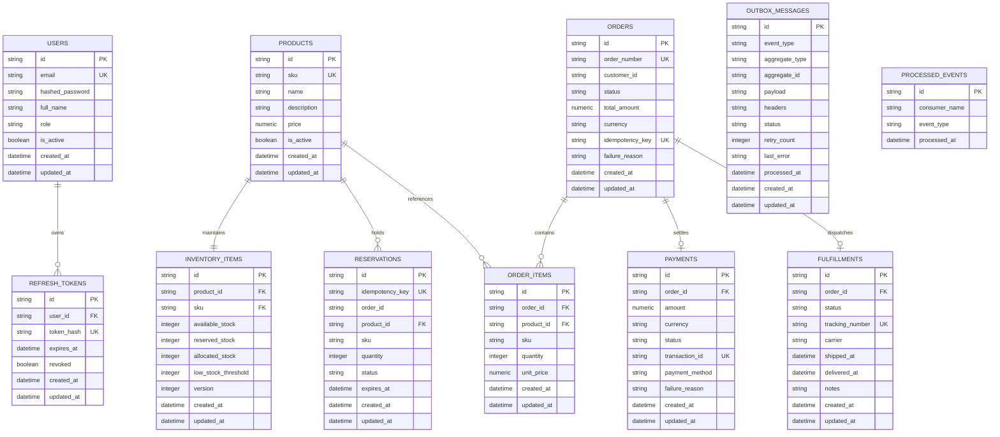
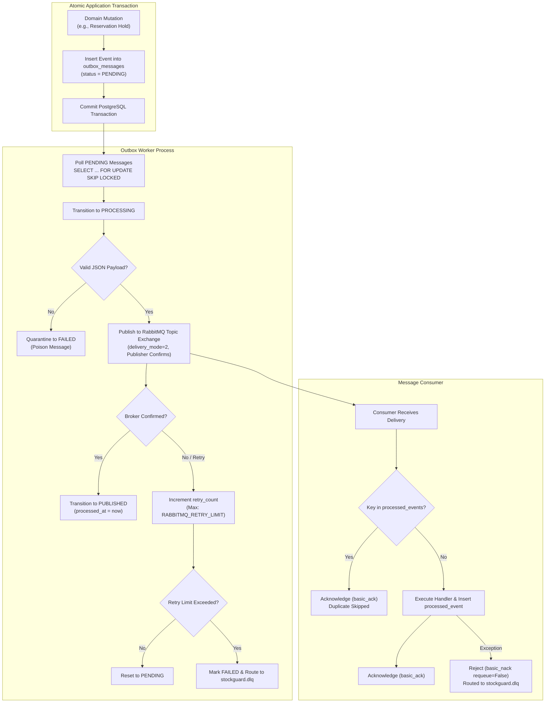
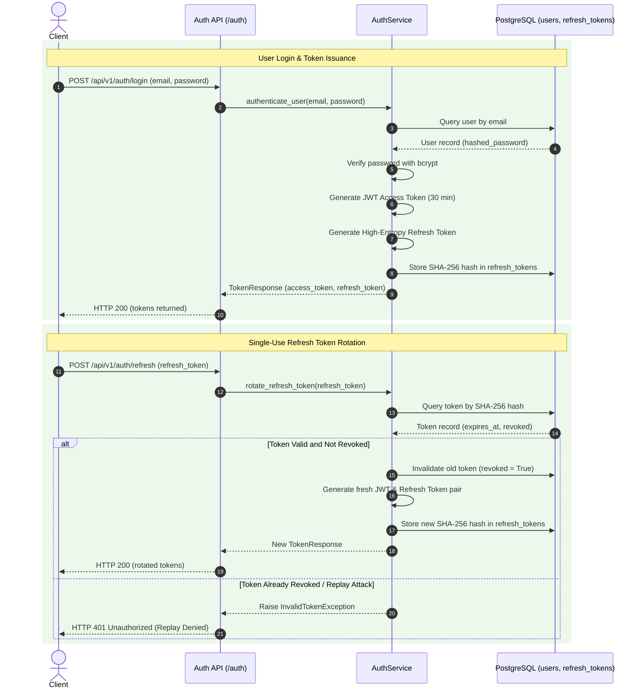

# StockGuard Architecture Specification

## 1. System Overview

StockGuard is an enterprise distributed inventory control and saga orchestration platform built to guarantee high-concurrency consistency, atomic stock reservations without race conditions, and reliable event-driven state propagation.

```
                           +-------------------------------------------------+
                           |                 Client Layer                    |
                           |       (Browser Console / Web UI / REST Client)  |
                           +------------------------+------------------------+
                                                    | HTTP + JWT Bearer
                                                    v
                           +-------------------------------------------------+
                           |           FastAPI Application Gateway           |
                           | - ObservabilityMiddleware (X-Correlation-ID)    |
                           | - Sliding-Window Rate Limiter (429 Retry-After) |
                           | - Prometheus Metrics (/metrics)                 |
                           +------------------------+------------------------+
                                                    |
         +--------------------+---------------------+--------------------+--------------------+
         |                    |                     |                    |                    |
+--------v-------+   +--------v-------+    +--------v-------+   +--------v-------+   +--------v-------+
|  Auth Service  |   |   Inventory    |    |  Reservation   |   |     Order      |   |  Outbox Admin  |
| - JWT Hashing  |   |    Service     |    |     Engine     |   |    Service     |   |    Service     |
| - Token Rotate |   | - Catalog SKU  |    | - Atomic Holds |   | - Order States |   | - Message Log  |
| - User RBAC    |   | - Restock Log  |    | - TTL Sweeper  |   | - IDOR Guard   |   | - Manual Flush |
+--------+-------+   +--------+-------+    +--------+-------+   +--------+-------+   +--------+-------+
         |                    |                     |                    |                    |
         |                    +---------------------+--------------------+                    |
         |                                          |                                         |
         |                                 +--------v-------+                                 |
         |                                 |      Saga      |                                 |
         |                                 |  Orchestrator  |                                 |
         |                                 +----+-------+---+                                 |
         |                                      |       |                                     |
         |                             +--------v---+ +-v----------+                          |
         |                             |  Payment   | |Fulfillment |                          |
         |                             | Simulator  | |  Service   |                          |
         |                             +--------+---+ +-+----------+                          |
         |                                      |       |                                     |
         +--------------------------------------+-------+-------------------------------------+
                                                |
                                                v (SQLAlchemy 2.0 / Psycopg 3 Pool)
         +------------------------------------------------------------------------------------+
         |                                 PostgreSQL 16 Engine                               |
         | - Strict CHECK Constraints (available_stock >= 0, reserved_stock >= 0)             |
         | - Pessimistic Row Locking (SELECT ... FOR UPDATE)                                  |
         | - Atomic Outbox Table (outbox_messages) & Deduplication Table (processed_events)   |
         +--------------------------------------+---------------------------------------------+
                                                |
                                                v (FOR UPDATE SKIP LOCKED Poll)
                                     +----------------------+
                                     |    Outbox Worker     |
                                     | - 60s Stuck Recovery |
                                     | - Poison Quarantine  |
                                     +----------+-----------+
                                                |
                        +-----------------------+-----------------------+
                        | (Primary)                                     | (Resilient Fallback)
                        v                                               v
       +---------------------------------+             +---------------------------------+
       |     RabbitMQ Message Broker     |             |    In-Memory Event Bus Fallback |
       | - Topic Exchange: stockguard.top|             | - Synchronous Thread-Safe Bus   |
       | - Publisher Confirms            |             | - Zero-Dependency Local Dev     |
       | - Dead-Letter Exchange: .dlq    |             +---------------------------------+
       +---------------------------------+
```

---

## 2. Concurrency Control & Database Schema

To guarantee that inventory never drops below zero and overselling is mathematically prevented under extreme traffic spikes:

1. **Database-Level CHECK Constraints:**
   - `chk_inventory_available_non_negative`: `CHECK (available_stock >= 0)`
   - `chk_inventory_reserved_non_negative`: `CHECK (reserved_stock >= 0)`
   - `chk_inventory_allocated_non_negative`: `CHECK (allocated_stock >= 0)`
   - `chk_inventory_threshold_non_negative`: `CHECK (low_stock_threshold >= 0)`

2. **Atomic Conditional SQL Decrement:**
   ```sql
   UPDATE inventory_items
   SET available_stock = available_stock - :requested_qty,
       reserved_stock = reserved_stock + :requested_qty,
       version = version + 1
   WHERE sku = :sku AND available_stock >= :requested_qty;
   ```
   If `available_stock < :requested_qty`, `rowcount == 0` and the transaction immediately raises `InsufficientStockException`. No lock escalations or phantom read vulnerabilities.

3. **Client Idempotency:**
   Every reservation requires an `idempotency_key`. The `reservations` table enforces a unique constraint on `idempotency_key`. Subsequent identical requests return the active reservation without redundant inventory deductions.

### Entity-Relationship (ER) Schema Diagram



---

## 3. Distributed Saga Orchestration & Compensation

Orders coordinate across Inventory, Payment, and Fulfillment via `SagaOrchestrator` executing automated backward compensation:

1. **Step 1 (Reservation):**
   - Transitions order status to `RESERVING`.
   - Acquires atomic hold for each order item with idempotency key `saga-res-{order_id}-{sku}`.
   - *Failure Compensation:* If any item has insufficient stock, releases all reservations acquired in earlier iterations. Order status transitions to `FAILED`.
   - On complete item hold, transitions order status to `RESERVED`.

2. **Step 2 (Payment):**
   - Transitions order status to `PAYMENT_PENDING`.
   - Dispatches payment request via `PaymentService.process_payment()`.
   - *Failure Compensation:* If payment is declined, the orchestrator triggers backward compensation releasing all acquired reservations back to `available_stock`. Order status transitions to `CANCELLED` (with failure reason).
   - On successful authorization, transitions order status to `PAID`.

3. **Step 3 (Fulfillment):**
   - Confirms all reservations (converting `reserved_stock` to `allocated_stock`).
   - Transitions order status to `FULFILLING`.
   - Dispatches fulfillment tracking via `FulfillmentService.initiate_fulfillment()`.
   - Transitions order status to `COMPLETED`.

### Saga Orchestration Sequence Diagram

```mermaid
sequenceDiagram
    autonumber
    actor Client
    participant API as Order API Gateway
    participant Saga as SagaOrchestrator
    participant Inv as ReservationEngine
    participant Pay as PaymentService
    participant Ful as FulfillmentService
    participant Out as OutboxService

    Client->>API: POST /api/v1/orders/{order_id}/checkout
    API->>Saga: execute_order_checkout(order_id)

    rect rgb(235, 248, 235)
        Note over Saga,Inv: Stage 1: Inventory Hold
        Saga->>Inv: create_reservation(sku, qty, idempotency_key)
        Inv-->>Saga: Reservation ACTIVE (reserved_stock incremented)
    end

    alt Payment Approved
        rect rgb(235, 248, 235)
            Note over Saga,Pay: Stage 2: Payment Authorization
            Saga->>Pay: process_payment(amount, order_id)
            Pay-->>Saga: Payment SUCCESS
        end
        rect rgb(235, 248, 235)
            Note over Saga,Ful: Stage 3: Fulfillment Dispatch
            Saga->>Ful: initiate_fulfillment(order_id)
            Ful-->>Saga: Tracking Number Generated
            Saga->>Inv: confirm_reservation (reserved -> allocated)
            Saga->>Out: Enqueue order.completed Event
            Saga-->>API: SagaExecutionResult (COMPLETED, HTTP 200)
            API-->>Client: Checkout Complete
        end
    else Payment Declined / Failure
        rect rgb(255, 235, 235)
            Note over Saga,Pay: Stage 2: Payment Decline
            Saga->>Pay: process_payment(amount, order_id)
            Pay-->>Saga: Payment FAILED (Card Declined)
            Note over Saga,Inv: Backward Compensation Initiated
            Saga->>Inv: release_reservation(reservation_id)
            Note over Inv: reserved_stock -> available_stock restored
            Inv-->>Saga: Reservation RELEASED
            Saga->>Out: Enqueue order.failed Event
            Saga-->>API: SagaExecutionResult (CANCELLED, compensated=True)
            API-->>Client: Payment Declined; Stock Released
        end
    end
```

---

## 4. Transactional Outbox Pattern & Messaging Pipeline

To eliminate dual-write discrepancies between the PostgreSQL database and the RabbitMQ message broker:

1. **Atomic Outbox Staging:**
   - Domain modifications and domain events write to the `outbox_messages` table within the **same local database transaction**.
2. **Concurrent Polling:**
   - Decoupled `OutboxWorker` instances claim batches of pending messages using `SELECT ... FOR UPDATE SKIP LOCKED`, preventing inter-worker contention.
3. **Publisher Confirms:**
   - Messages publish to RabbitMQ `stockguard.topic` with `delivery_mode=2` (Persistent) and channel publisher confirms (`confirm_delivery()`).
   - On broker confirmation, message status transitions to `PUBLISHED` with timestamp.
4. **Stuck Worker Crash Recovery:**
   - Messages left in `PROCESSING` status for over 60 seconds (due to unexpected process termination or network drops) are automatically recovered by `recover_stuck_messages()` and reset to `PENDING`.
5. **Poison Message Isolation:**
   - Unparseable or corrupt payloads are immediately quarantined to `FAILED` status, logging the root cause without crashing workers or blocking subsequent messages.
6. **Consumer Deduplication:**
   - AMQP consumers check the `processed_events` table by compound key `event_id:consumer_name`. Duplicate deliveries are acknowledged and skipped. Unhandled errors route to dead-letter exchange `stockguard.dlq`.



---

## 5. Security & Identity Architecture

StockGuard implements defense-in-depth API security:

1. **JWT Authentication & Token Lifecycle:**
   - Stateless JWT access tokens signed with HMAC-SHA256 (30-minute expiration).
   - Stateful refresh tokens stored as SHA-256 hashes in `refresh_tokens` (7-day expiration). Every refresh triggers **token rotation** and revocation of prior tokens, preventing replay attacks.
2. **Password Hashing:**
   - Handled via `bcrypt` (12 rounds) with Argon2 verification compatibility.
   - Plaintext passwords and tokens are never persisted or exposed in application logs.
3. **Role-Based Access Control (RBAC):**
   - Fine-grained role hierarchy (`ADMIN`, `INVENTORY_MANAGER`, `CUSTOMER`, `SERVICE`).
   - Least-privilege validation enforced at the API boundary via FastAPI dependencies (`require_role`).
4. **IDOR Prevention:**
   - Resource ownership checks (`verify_resource_ownership`) verify customer ownership of orders and reservations.
5. **Sliding-Window Rate Limiting:**
   - `InMemoryRateLimiter` enforces rate boundaries on `/auth/*` and sensitive endpoints, responding with HTTP 429 and `Retry-After` headers.

### Authentication & Token Rotation Sequence



---

## 6. Outbox Concurrency & Crash Recovery

1. **`FOR UPDATE SKIP LOCKED`:**
   - Multiple background outbox workers safely poll pending messages concurrently without double-publishing.
2. **Stuck Event Recovery:**
   - Messages left in `PROCESSING` status for over 60 seconds (due to unexpected process termination or network drops) are automatically recovered by `recover_stuck_messages()` and restored to `PENDING`.
3. **Poison Message Quarantine:**
   - Messages with corrupt or unparseable payloads are immediately isolated to `FAILED` status, logging the root cause without crashing workers or blocking healthy messages.

---

## 7. Observability & Telemetry

1. **Correlation IDs & Request Tracing:**
   - `ObservabilityMiddleware` assigns or propagates `X-Correlation-ID` across inbound requests and downstream logs.
   - Optional distributed tracing via OpenTelemetry (`opentelemetry-instrumentation-fastapi`).
2. **Prometheus Metrics Exposition:**
   - Metrics available at `/metrics` and `/api/v1/health/metrics` covering request throughput, P50/P95 latencies, reservation outcomes, and outbox backlog gauges.
3. **Kubernetes Health Probes:**
   - `/api/v1/health/live` (process liveness).
   - `/api/v1/health/ready` (PostgreSQL connectivity check).

---

## 8. Architecture Decision Records (ADRs)

Key architectural trade-offs are documented in [`docs/adr/`](adr/):
- **[ADR 001: Modular Monolith with Decoupled Entrypoints](adr/001-modular-monolith-vs-microservices.md)**
- **[ADR 002: Transactional Outbox Pattern vs Dual Writes](adr/002-transactional-outbox-vs-dual-writes.md)**
- **[ADR 003: Pessimistic Row Locking vs Distributed Locks](adr/003-pessimistic-locking-vs-optimistic-concurrency.md)**
- **[ADR 004: Orchestrator-Driven Saga vs Event Choreography](adr/004-saga-orchestration-vs-choreography.md)**
- **[ADR 005: JWT Authentication, RBAC & Refresh Token Rotation](adr/005-jwt-rbac-refresh-token-rotation.md)**
